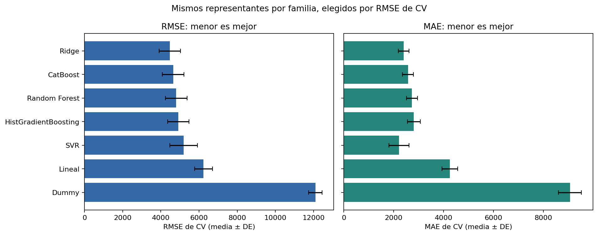
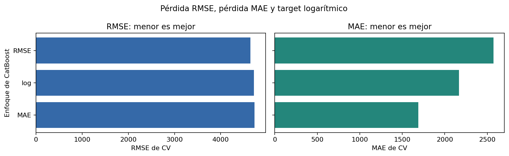
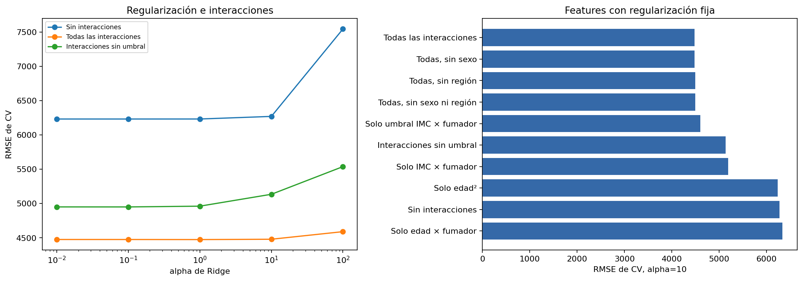
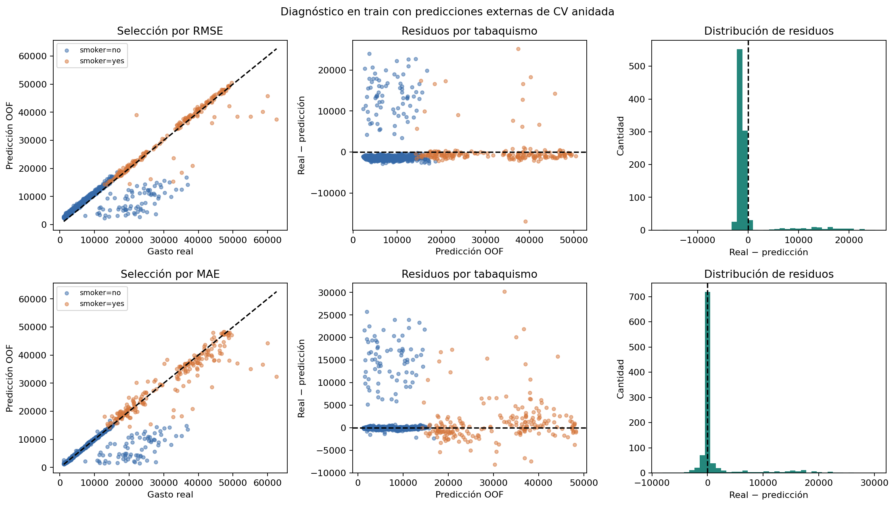

# Predicción de gastos médicos

Proyecto educativo del workshop 2 de ciencia de datos. Un único notebook contiene la lectura por URL, exploración, modelos, ajuste y resultados.

[Ver el notebook ejecutado](insurance_costs_regression_mejorado.ipynb)

## Qué se estudia

- Recuperar edad como predictor y ajustar transformaciones dentro de pipelines.
- Ajustar alpha de Ridge y comparar interacciones y exclusión de columnas.
- Comparar CatBoost con pérdida RMSE, pérdida MAE y target logarítmico.
- Distinguir selección por RMSE y por MAE.
- Evaluar el proceso de selección con CV anidada y analizar errores OOF.

## Evaluación

Train: 1002 filas. Se conserva el split original y el test ya observado queda fuera de los nuevos experimentos. La búsqueda usa cinco folds de train; la CV anidada usa tres folds externos y tres internos, con la misma lista predefinida de candidatos.

Las siguientes métricas se calculan reuniendo las predicciones externas (OOF) de la CV anidada. Evalúan dos procedimientos de selección; la configuración elegida puede cambiar entre folds.

| Selección interna por | RMSE OOF anidado | MAE OOF anidado | R² OOF anidado |
| --- | ---: | ---: | ---: |
| RMSE | 4,526.83 | 2,401.34 | 0.8597 |
| MAE | 4,849.17 | 1,802.08 | 0.8390 |

### Candidatos para ajustar con todo train

- **RMSE:** Ridge | Todas las interacciones | alpha=1.
- **MAE:** CatBoost MAE | depth=5 | l2=3.

## Modelos e interacciones

El gráfico principal muestra una configuración por familia, elegida por RMSE de CV. Ambos paneles muestran esas mismas configuraciones. Las barras de error son desviaciones entre folds, no intervalos de confianza. Los puntajes de búsqueda pueden ser optimistas por selección.

CatBoost se muestra también por enfoque: pérdida cuadrática, pérdida absoluta y target logarítmico. Se conservan las mismas configuraciones entre paneles para visualizar el intercambio entre métricas.

La ablation compara features con alpha=10; la curva muestra el ajuste de alpha.

## Análisis de errores

Predicciones de validación externa dentro de train; color por tabaquismo. Se estudia el equilibrio entre sobreestimaciones frecuentes y subestimaciones grandes. No se eliminan casos difíciles ni se corrigen predicciones a partir de estos gráficos.

## Referencia histórica de test

La primera versión de Ridge con todas las interacciones y alpha=10 obtuvo RMSE 4090.22, MAE 2277.19 y R² 0.8870 en 335 filas de test. **Esos valores no corresponden a los nuevos candidatos.** El test se observó antes de esta ampliación y no se vuelve a evaluar.

## Cómo reproducirlo

Abrir el `.ipynb` en Jupyter o Google Colab y ejecutar las celdas en orden. La primera instala las bibliotecas. Los datos se leen desde la URL del workshop; no se necesitan scripts, un archivo de dependencias ni un CSV local. La CV anidada puede tardar algunos minutos en CPU. Las salidas ya están guardadas.

## Datos y alcance

[Medical Cost Personal Datasets — Miri Choi, Kaggle](https://www.kaggle.com/datasets/mirichoi0218/insurance). Se usa el [CSV del workshop](https://raw.githubusercontent.com/bencmbit/datasets/refs/heads/master/insurance.csv). Se predicen gastos médicos facturados con edad, sexo registrado, IMC, dependientes, tabaquismo y región. Se conserva una copia de una fila exactamente repetida: 1337 filas de 1338. Sin ID no se puede confirmar si era un error. El dataset no contiene precios argentinos.

Esta es una evaluación interna de las configuraciones y del proceso de selección incluidos. Varias hipótesis ya se exploraron con estos datos; CV anidada no convierte el proyecto en una validación externa. No se afirma superioridad universal ni causalidad. R² no es porcentaje de aciertos.

## Versiones usadas

numpy 2.3.5, pandas 2.2.3, scikit-learn 1.8.0, catboost 1.2.10, matplotlib 3.10.8.
